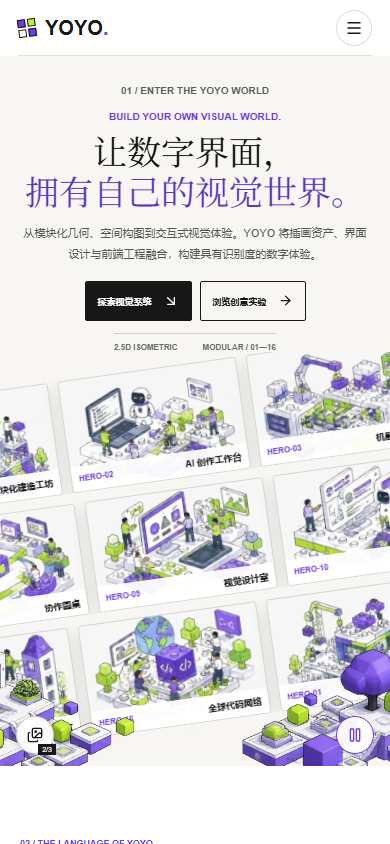

# YOYO Art Landing

YOYO Art Landing 是一个围绕模块化等距插画、编辑式排版和可操作视觉实验构建的响应式单页应用。项目以 Oil UI Art Landing 作为结构、叙事和动效研究对象，再用 YOYO 的品牌、用户提供的插画和交互内容重新表达；**当前页面不是 Oil UI 的逐像素克隆**。参考分析、实测边界和当前实现映射见[原站与前端实现解析](docs/REFERENCE_ANALYSIS.md)。

## 预览

- 在线页面：https://yoyo-art-landing.vercel.app
- GitHub：<https://github.com/1byteone/yoyo-art-landing>
- 本地开发：<http://127.0.0.1:4179/>

### 桌面首屏


### 首页滑动场景


### 移动端首屏



## 原站剖析摘要

参考页面：[Oil UI Art Landing](https://ui.oiloil.org/art-landing/)。原站以艺术指导为主线：品牌导航和居中 Hero 引入“艺术化官网”，接着解释整页风格统一、展示行业适配，再以 20 个真实案例和购买 CTA 收束。首屏不是孤立横幅，而是由三条反向滑动的案例轨道、斜置卡片墙和底部前景共同构成的分层场景。

| 观察维度 | 原站观察 / 证据                                                                       | YOYO 当前实现                                                                            |
| -------- | ------------------------------------------------------------------------------------- | ---------------------------------------------------------------------------------------- |
| 页面叙事 | Hero → 风格说明 → 全页一致性 → 行业场景 → 20 个案例 → 产品转化                        | 品牌世界 → 视觉规则 → 空间构图 → 行业应用 → 创意实验 → 作品/资产 → 收尾                  |
| 首屏几何 | 历史浏览器记录：Header 56px、Hero 高 844px、展示卡片约 256×160px、14px 间距、-8° 斜置 | 保留 56px Header、三轨、卡片节奏和斜置关系；按 YOYO 文案与视口重排                       |
| 图片运动 | 三轨方向左 / 右 / 左；以重复素材组形成循环，运动和画面层级共同构成 Hero               | CSS 线性关键帧 + 重复组；`ResizeObserver` 按真实轨道宽度计算周期；支持暂停和减少动态偏好 |
| 图像语义 | 胶片、版画、光学、静物风格的案例网页预览与植物/环境前景                               | YOYO 等距模块场景与三种透明前景；不是原站图片的替代授权                                  |
| 内容目标 | 展示 Oil UI Pro 的艺术化网页能力并引导购买                                            | 展示 YOYO 的模块化视觉系统和交互实验                                                     |

几何数据来自历史 **1440×900** 视口；原站其他断点的细节没有足够实测证据。当前 YOYO 页面在 1920、1440、1280、768 和 390px 宽度做了本地回归，这些是本项目适配结果，不代表原站测量。完整事实/推断区分及差异说明见[原站与前端实现解析](docs/REFERENCE_ANALYSIS.md)和[响应式规范](docs/RESPONSIVE_SPEC.md)。

## 页面功能

- 三条连续滚动的首页图片轨道，轨道方向交替；有真实暂停/继续控件，并响应 `prefers-reduced-motion`。
- 三种透明前景切换；点击场景可查看图片、尺寸、来源和用途信息。
- 视觉原则标签、颜色色样、空间场景和图层控制、行业应用比较。
- 作品分类、作品详情、辅助资产搜索/过滤/分页，以及动态海报、工作流和模块拼搭实验。
- 原生语义化按钮、链接、表单和对话框；提供键盘操作、可见焦点和状态 ARIA。

## 技术实现

| 术语                     | 在本项目中的用途                                           | 代码入口                                                        |
| ------------------------ | ---------------------------------------------------------- | --------------------------------------------------------------- |
| React + TypeScript       | 组件边界、交互状态、资产和页面数据类型                     | `src/App.tsx`、`src/components/`、`src/data/`                   |
| Vite                     | 本地开发服务器和静态生产构建                               | `vite.config.ts`、`package.json`                                |
| CSS Grid / Flexbox       | 桌面 12 栏作品编排、轨道行列、导航和控件布局               | `src/styles/yoyo-experience.css`、`src/styles/hero-marquee.css` |
| CSS custom properties    | 颜色、间距、卡片宽度、循环速度等可调设计令牌               | `src/styles/design-tokens.css`、`src/styles/tokens.css`         |
| CSS keyframes            | 无缝横向轨道；两组等宽图片按 `translateX(±50%)` 循环       | `src/styles/hero-marquee.css`                                   |
| `ResizeObserver`         | 容器/卡片尺寸变化后重算循环时间，保持 CSS px/s 运动速度    | `src/components/HeroImageWall.tsx`                              |
| `requestAnimationFrame`  | 合并滚动事件并更新低幅度视差，避免每个滚动事件重复读写布局 | `src/components/ScrollReveal.tsx`                               |
| `IntersectionObserver`   | 区块进入视口时触发一次揭示效果                             | `src/components/ScrollReveal.tsx`                               |
| `prefers-reduced-motion` | 关闭视差/揭示动画和自动运动，并让控件反映系统偏好          | `src/components/`、`src/styles/`                                |
| Responsive breakpoints   | 900px / 700px / 380px 以下调整内容流、导航、网格和按钮密度 | `src/styles/yoyo-experience.css`、`src/styles/hero-marquee.css` |
| Playwright               | 检查交互、素材解码、横向溢出和五种目标视口截图             | `tests/`、`playwright.config.ts`                                |

更完整的 DOM / CSS / 动效 / 无障碍 / 素材 / 验收术语映射见[原站与前端实现解析](docs/REFERENCE_ANALYSIS.md)。

## 本地开发

前置条件：Node.js 22+ 和 npm。

```bash
npm install
npm run dev
```

Vite 会输出实际本地地址，默认端口为 `5173`。端到端测试使用 `127.0.0.1:4179`。

## 质量检查

```bash
npm run assets:inventory
npm run verify
npm run build
```

`npm run verify` 依次运行 TypeScript、ESLint、Prettier 和 Playwright。Playwright 需要可用的 Chromium；视觉测试覆盖 1920×1080、1440×900、1280×800、768×1024、390×844，并将截图写入本地 `artifacts/after/`（该目录不会推送到公开仓库）。

## 文档索引

- [原站与前端实现解析](docs/REFERENCE_ANALYSIS.md)：参考页面结构、观测证据边界、实现术语和差距。
- [参考素材提交清单](docs/REFERENCE_ASSET_CHECKLIST.md)：交给 Agent 前应准备的截图、原始图片、字体、动效和版权信息。
- [可复用的像素级复刻 Prompt](prompts/PIXEL_ACCURATE_RECONSTRUCTION.md)：从审计、素材映射、实现到视觉回归的完整 Agent 指令。
- [设计系统](docs/DESIGN_SYSTEM.md)
- [组件架构](docs/COMPONENT_ARCHITECTURE.md)
- [交互规范](docs/INTERACTION_SPEC.md)
- [响应式规范](docs/RESPONSIVE_SPEC.md)
- [素材清单](docs/ASSET_INVENTORY.md)
- [项目审计](docs/PROJECT_AUDIT.md)
- [视觉差距报告](docs/VISUAL_GAP_REPORT.md)
- [视觉 QA 报告](docs/VISUAL_QA_REPORT.md)

`docs/reconstruction/` 中保留了历史研究笔记。原站截图、差分图、临时素材和 Playwright 输出留在本地工作目录，不随公开仓库发布。

## 素材与授权说明

当前 16 张主视觉是用户提供的 1536×1024 联系表裁切出的 384×256 WebP，不是 16 张独立高分辨率源图。三张 Hero 前景图作为独立透明素材保留。公开仓库中的代码和用户提供素材没有附带开源/再分发许可证；复用前应单独确认权利。项目不打包原站的标志、原站图片或原站页面截图。
